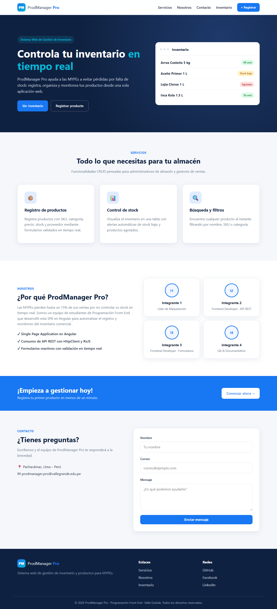
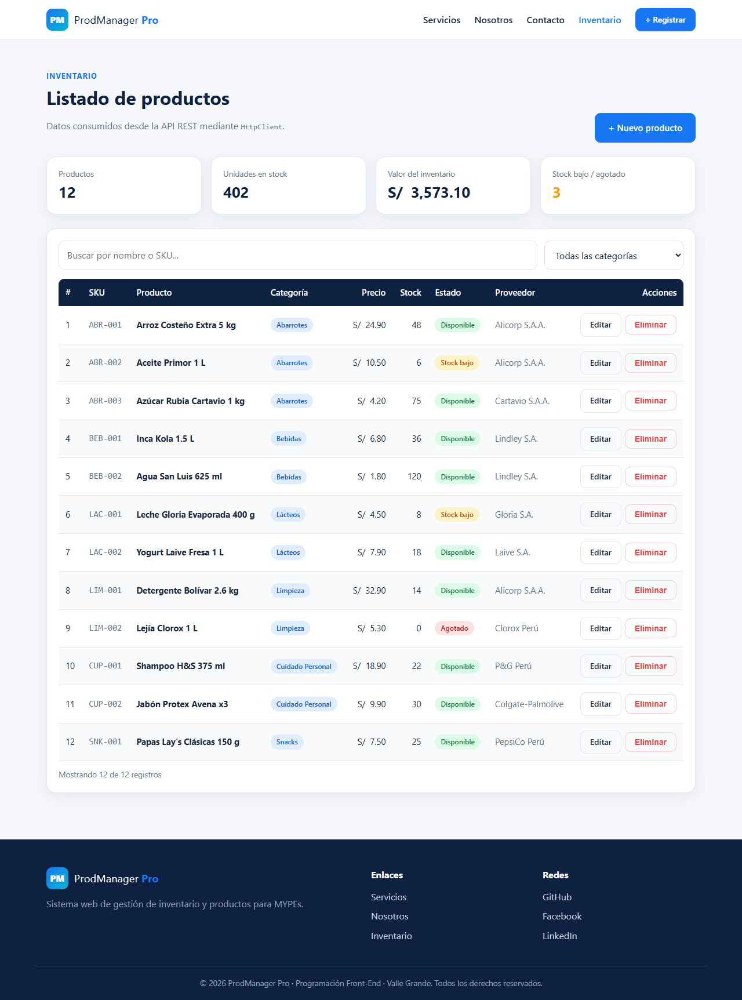
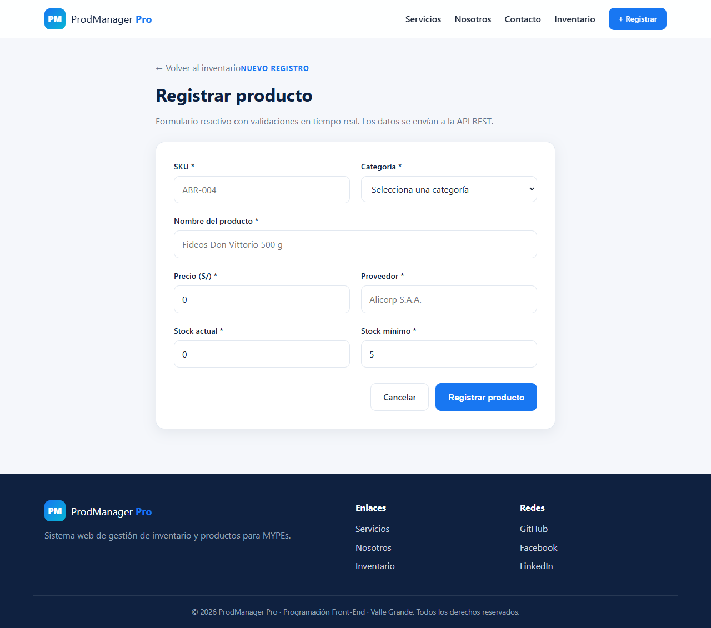

# ProdManager Pro v1.0

**Sistema Web de Gestión de Inventario y Productos** — Proyecto CRUD en Angular
Programación Front-End · Sesión 12 · Valle Grande



## Problema y solución

Las MYPEs pierden hasta un 15% de sus ventas por falta de control en tiempo real sobre el stock y la
categorización de sus productos. **ProdManager Pro** es una SPA en Angular que automatiza el registro y monitoreo
del inventario comercial, con alertas de stock bajo y productos agotados.

**Público objetivo:** administradores de almacén y gestores de ventas en comercios minoristas.

### Objetivos

- **General:** desarrollar una SPA funcional e intuitiva en Angular que automatice el registro y monitoreo del inventario.
- **Específicos:**
  1. Implementar una Landing Page atractiva para la presentación del producto.
  2. Consumir una API REST mediante RxJS y Angular Services.
  3. Validar entradas de datos en tiempo real mediante Reactive Forms.

## Tecnologías

| Tecnología | Uso |
|---|---|
| Angular 19 (NgModules) | Framework SPA, componentes y enrutamiento |
| TypeScript | Tipado del modelo `Product` y servicios |
| HttpClient + RxJS | Consumo de la API REST (Observables) |
| Reactive Forms | Formularios con validaciones en tiempo real |
| JSON Server | API REST simulada a partir de `db.json` |
| CSS3 (Grid / Flexbox) | Diseño responsivo sin librerías externas |

## Estructura del proyecto

```
src/
└── app/
    ├── components/
    │   ├── landing/          → Hero, Servicios, Nosotros, CTA y Contacto
    │   ├── product-list/     → Tabla con 10 registros, búsqueda, filtros, editar y eliminar
    │   └── product-form/     → Formulario reactivo para registrar / editar productos
    ├── services/
    │   └── product.service.ts → HttpClient: getAll, getById, create, update, delete
    ├── models/
    │   └── product.model.ts   → Interfaz Product y categorías
    ├── app.component.ts       → Layout: Navbar + router-outlet + Footer
    ├── app-routing.module.ts  → Rutas de la SPA
    └── app.module.ts          → Módulo raíz (ReactiveForms, HttpClient)
db.json                        → Base de datos de la API REST (JSON Server)
```

## Flujo de datos

```
1. API REST (JSON Server · http://localhost:3000/products)
        ↓  JSON
2. Angular Service  → ProductService · HttpClient.get<Product[]>() · Observable
        ↓  subscribe()
3. Angular Component → ProductListComponent guarda los datos en products[]
        ↓  data binding
4. Template (HTML)   → @for renderiza la tabla de productos
```

## Endpoints de la API

| Método | Endpoint | Acción |
|---|---|---|
| GET | `/products` | Listar productos |
| GET | `/products/:id` | Obtener un producto |
| POST | `/products` | Registrar producto |
| PUT | `/products/:id` | Actualizar producto |
| DELETE | `/products/:id` | Eliminar producto |

## Rutas de la aplicación

| Ruta | Componente |
|---|---|
| `/` | Landing Page |
| `/productos` | Listado de productos |
| `/productos/nuevo` | Formulario de registro |
| `/productos/editar/:id` | Formulario de edición |

## Instalación y ejecución

Requisitos: Node.js 18+ y npm.

```bash
git clone https://github.com/jorgevilcapuma/T04_Gesti-n-de-Inventarios-y-Productos.git
cd T04_Gesti-n-de-Inventarios-y-Productos
npm install

# Opción 1: API + Angular a la vez
npm run dev

# Opción 2: en dos terminales
npm run api     # API REST en http://localhost:3000/products
ng serve        # App en http://localhost:4200
```

> Si la tabla muestra "No se pudo conectar con la API REST", verifica que `npm run api` esté corriendo.

### Opción con base de datos MySQL

El backend de [backend/server.js](backend/server.js) (Express + mysql2) expone los mismos endpoints en el puerto 3000,
así que el frontend no cambia.

1. Instalar MySQL Server (o XAMPP) y encenderlo.
2. Ejecutar [docs/database.sql](docs/database.sql) en MySQL Workbench para crear la base `prodmanager_pro` con 10 productos.
3. Copiar `backend/.env.example` como `backend/.env` y poner el usuario y contraseña de MySQL.
4. Ejecutar `npm run dev:mysql` (o `npm run api:mysql` + `ng serve`).

> No ejecutar `npm run api` y `npm run api:mysql` a la vez: ambos usan el puerto 3000.

## Evidencias

| Listado (10 registros) | Formulario reactivo |
|---|---|
|  |  |

## Integrantes

| Integrante | Rol | Responsabilidad |
|---|---|---|
| Jorge Vilcapuma Trujillo | Líder de Maquetación · Frontend Developer | Diseño UI/UX, Landing Page, ProductService, HttpClient y observables RxJS |
| Daniel Yerson Leyva Cespedes | Frontend Developer · QA & Documentation | Formulario reactivo, validaciones, estados CRUD, pruebas, README y diapositiva |

## Entregables

- Diapositiva grupal: [docs/diapositiva.html](docs/diapositiva.html) (abrir en el navegador → Imprimir → Guardar como PDF, horizontal)
- Guion del video (5–7 min): [docs/guion-video.md](docs/guion-video.md)
